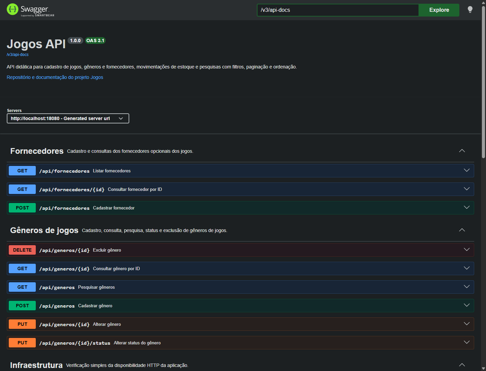
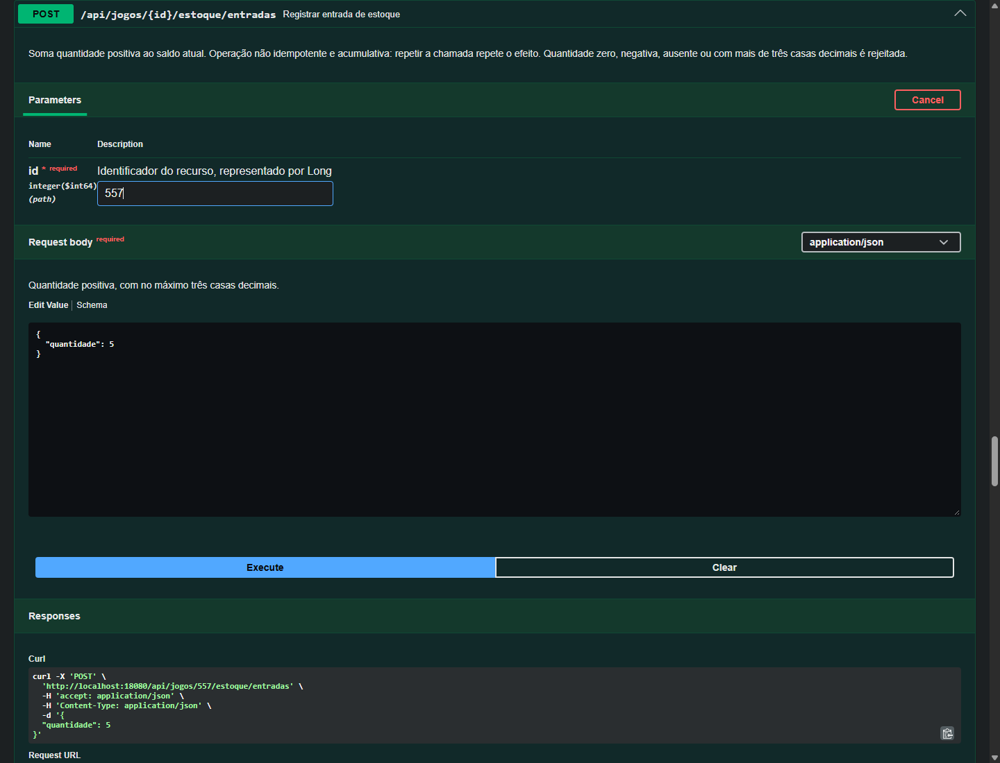
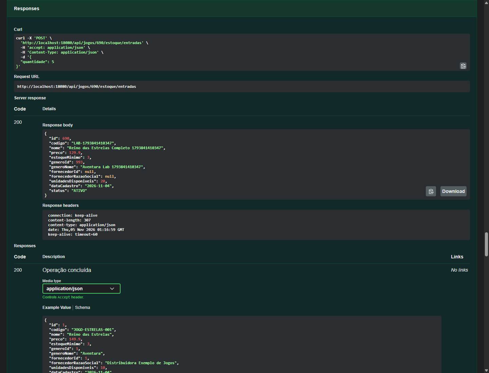

# Aula 09 — Evidências reais de execução

Evidências iniciais em 04/11/2026 (America/Sao_Paulo); revisão após auditoria registrada ao final em 05/11/2026. Os timestamps ISO com Z abaixo estão em UTC e podem indicar 05/11; isso não altera o tipo LocalDateTime usado por ApiError.

## Testes Maven e ambiente

Java 21.0.12, Spring Boot 4.0.8, springdoc 3.0.3, PostgreSQL 17.11. Baseline: 63 testes aprovados. Ao final da implementação inicial: **82 testes, 0 falhas, 0 erros, 0 ignorados; BUILD SUCCESS**. Nenhum dos 63 testes anteriores foi removido ou alterado.

OpenApiDocumentationTest: 16 testes; OpenApiProfilesTest: 3 testes. Este último usa contexto web sem DataSource e carrega os arquivos de profile reais. Dev/test publicam JSON/YAML/UI; prod retorna 404, sem conectar a banco de produção.

A cópia de reprodução foi criada em target/aula09-reproducao, sem .git, .env ou classes compiladas. Compilação/testes a partir das fontes: **82 testes aprovados**. A configuração local de DB_TEST foi importada externamente, sem copiar credenciais para essa cópia.

## Geração inicial, antes das anotações

JSON, YAML e HTML final da UI retornaram HTTP 200. A captura abaixo provém do documento recebido inicialmente, não de uma especificação reconstruída:

```json
{
  "info": {
    "title": "OpenAPI definition",
    "version": "v0"
  },
  "entry": {
    "summary": null,
    "description": null,
    "responses": [
      "200"
    ]
  },
  "paginationParameters": [
    {
      "name": "nome",
      "required": false
    },
    {
      "name": "status",
      "required": false
    },
    {
      "name": "generoId",
      "required": false
    },
    {
      "name": "fornecedorId",
      "required": false
    },
    {
      "name": "abaixoEstoqueMinimo",
      "required": false
    },
    {
      "name": "pageable",
      "required": true
    }
  ]
}
```

Depois do enriquecimento, o documento real identifica a API e expõe os parâmetros corretos:

```json
{
  "openapi": "3.1.0",
  "info": {
    "title": "Jogos API",
    "description": "API didática para cadastro de jogos, gêneros e fornecedores, movimentações de estoque e pesquisas com filtros, paginação e ordenação.",
    "contact": {
      "name": "Projeto acadêmico Jogos — Sistemas de Informação"
    },
    "version": "1.0.0"
  },
  "paths": 11,
  "schemas": 13,
  "entryResponses": [
    "200",
    "400",
    "404"
  ],
  "paginationParameters": [
    "nome",
    "status",
    "generoId",
    "fornecedorId",
    "abaixoEstoqueMinimo",
    "page",
    "size",
    "sort"
  ]
}
```

A exportação YAML real está em [aula-09-openapi.yaml](aula-09-openapi.yaml). O teste de equivalência confere metadados, paths, componentes, tags e referências contra o JSON gerado; o teste de YAML interpreta os bytes UTF-8.

## Laboratório visual

Execução observada: `2026-11-05T00:44:05.510Z`. Browser: `Chrome/156.0.8078.80`. **Sete cenários e 13 chamadas via Swagger UI**, com 18 operações renderizadas. Os botões Try it out e Execute foram utilizados; as respostas abaixo foram capturadas na rede do navegador.





IDs, timestamps e valores das respostas a seguir foram preservados. Dados são fixtures criadas no banco de testes; não são exemplos de produção. A limpeza ao fim removeu somente o jogo e o gênero desta execução.

### cadastrarGenero — HTTP 201

`POST http://localhost:18080/api/generos`

Corpo enviado:

```json
{
  "nome": "Aventura Lab 1793839427282"
}
```

Location observado: `/api/generos/806`.

Corpo recebido:

```json
{
  "id": 806,
  "nome": "Aventura Lab 1793839427282",
  "status": "ATIVO"
}
```

### cadastrarJogo — HTTP 201

`POST http://localhost:18080/api/jogos`

Corpo enviado:

```json
{
  "codigo": "LAB-1793839427282",
  "nome": "Reino das Estrelas 1793839427282",
  "unidadesDisponiveis": 10,
  "preco": 149.9,
  "estoqueMinimo": 3,
  "generoId": 806,
  "fornecedorId": null
}
```

Location observado: `/api/jogos/557`.

Corpo recebido:

```json
{
  "id": 557,
  "codigo": "LAB-1793839427282",
  "nome": "Reino das Estrelas 1793839427282",
  "preco": 149.9,
  "estoqueMinimo": 3,
  "generoId": 806,
  "generoNome": "Aventura Lab 1793839427282",
  "fornecedorId": null,
  "fornecedorRazaoSocial": null,
  "unidadesDisponiveis": 10,
  "dataCadastro": "2026-11-04",
  "status": "ATIVO"
}
```

### consultarJogo — HTTP 200

`GET http://localhost:18080/api/jogos/557`

Sem corpo de entrada.

Corpo recebido:

```json
{
  "id": 557,
  "codigo": "LAB-1793839427282",
  "nome": "Reino das Estrelas 1793839427282",
  "preco": 149.9,
  "estoqueMinimo": 3,
  "generoId": 806,
  "generoNome": "Aventura Lab 1793839427282",
  "fornecedorId": null,
  "fornecedorRazaoSocial": null,
  "unidadesDisponiveis": 10,
  "dataCadastro": "2026-11-04",
  "status": "ATIVO"
}
```

### alterarJogo — HTTP 200

`PUT http://localhost:18080/api/jogos/557`

Corpo enviado:

```json
{
  "nome": "Reino das Estrelas Completo 1793839427282",
  "preco": 129.9,
  "estoqueMinimo": 3,
  "generoId": 806,
  "fornecedorId": null
}
```

Corpo recebido:

```json
{
  "id": 557,
  "codigo": "LAB-1793839427282",
  "nome": "Reino das Estrelas Completo 1793839427282",
  "preco": 129.9,
  "estoqueMinimo": 3,
  "generoId": 806,
  "generoNome": "Aventura Lab 1793839427282",
  "fornecedorId": null,
  "fornecedorRazaoSocial": null,
  "unidadesDisponiveis": 10,
  "dataCadastro": "2026-11-04",
  "status": "ATIVO"
}
```

### entradaEstoque — HTTP 200

`POST http://localhost:18080/api/jogos/557/estoque/entradas`

Corpo enviado:

```json
{
  "quantidade": 5
}
```

Corpo recebido:

```json
{
  "id": 557,
  "codigo": "LAB-1793839427282",
  "nome": "Reino das Estrelas Completo 1793839427282",
  "preco": 129.9,
  "estoqueMinimo": 3,
  "generoId": 806,
  "generoNome": "Aventura Lab 1793839427282",
  "fornecedorId": null,
  "fornecedorRazaoSocial": null,
  "unidadesDisponiveis": 15,
  "dataCadastro": "2026-11-04",
  "status": "ATIVO"
}
```

### entradaEstoque — HTTP 200

`POST http://localhost:18080/api/jogos/557/estoque/entradas`

Corpo enviado:

```json
{
  "quantidade": 5
}
```

Corpo recebido:

```json
{
  "id": 557,
  "codigo": "LAB-1793839427282",
  "nome": "Reino das Estrelas Completo 1793839427282",
  "preco": 129.9,
  "estoqueMinimo": 3,
  "generoId": 806,
  "generoNome": "Aventura Lab 1793839427282",
  "fornecedorId": null,
  "fornecedorRazaoSocial": null,
  "unidadesDisponiveis": 20,
  "dataCadastro": "2026-11-04",
  "status": "ATIVO"
}
```

### pesquisarJogos — HTTP 200

`GET http://localhost:18080/api/jogos?nome=Reino%20das%20Estrelas%20Completo%201793839427282&status=ATIVO&generoId=806&abaixoEstoqueMinimo=false&page=0&size=5&sort=nome%2Casc`

Sem corpo de entrada.

Corpo recebido:

```json
{
  "conteudo": [
    {
      "id": 557,
      "codigo": "LAB-1793839427282",
      "nome": "Reino das Estrelas Completo 1793839427282",
      "preco": 129.9,
      "estoqueMinimo": 3,
      "generoId": 806,
      "generoNome": "Aventura Lab 1793839427282",
      "fornecedorId": null,
      "fornecedorRazaoSocial": null,
      "unidadesDisponiveis": 20,
      "dataCadastro": "2026-11-04",
      "status": "ATIVO"
    }
  ],
  "pagina": 0,
  "tamanho": 5,
  "totalElementos": 1,
  "totalPaginas": 1,
  "primeira": true,
  "ultima": true
}
```

### entradaEstoque — HTTP 400

`POST http://localhost:18080/api/jogos/557/estoque/entradas`

Corpo enviado:

```json
{
  "quantidade": 0
}
```

Corpo recebido:

```json
{
  "timestamp": "2026-11-04T21:43:59.0468507",
  "status": 400,
  "error": "Bad Request",
  "message": "Dados inválidos",
  "path": "/api/jogos/557/estoque/entradas",
  "fields": {
    "quantidade": "deve ser maior que 0"
  }
}
```

### consultarJogo — HTTP 404

`GET http://localhost:18080/api/jogos/9223372036854775807`

Sem corpo de entrada.

Corpo recebido:

```json
{
  "timestamp": "2026-11-04T21:44:00.2336769",
  "status": 404,
  "error": "Not Found",
  "message": "Jogo não encontrado",
  "path": "/api/jogos/9223372036854775807",
  "fields": {}
}
```

### cadastrarGenero — HTTP 409

`POST http://localhost:18080/api/generos`

Corpo enviado:

```json
{
  "nome": "Aventura Lab 1793839427282"
}
```

Corpo recebido:

```json
{
  "timestamp": "2026-11-04T21:44:01.1070544",
  "status": 409,
  "error": "Conflict",
  "message": "Nome do gênero já cadastrado",
  "path": "/api/generos",
  "fields": {}
}
```

### excluirGenero — HTTP 409

`DELETE http://localhost:18080/api/generos/806`

Sem corpo de entrada.

Corpo recebido:

```json
{
  "timestamp": "2026-11-04T21:44:02.6897442",
  "status": 409,
  "error": "Conflict",
  "message": "Gênero não pode ser excluído porque possui jogos",
  "path": "/api/generos/806",
  "fields": {}
}
```

### excluirJogo — HTTP 204

`DELETE http://localhost:18080/api/jogos/557`

Sem corpo de entrada.

Resposta sem corpo; HTTP 204 confirmado.

### excluirGenero — HTTP 204

`DELETE http://localhost:18080/api/generos/806`

Sem corpo de entrada.

Resposta sem corpo; HTTP 204 confirmado.

## Coleção Postman existente

Execução: `2026-11-05T00:51:47.693Z`. Executor: Node HTTP + scripts Postman + comparação com schemas OpenAPI. **30 requisições e 43 verificações Postman aprovadas**. Os schemas de entrada/sucesso/erro foram comparados ao OpenAPI em todas as chamadas aplicáveis; 201 confirmou Location e 204 confirmou corpo vazio. Os pedidos negativos mantêm seus códigos esperados.

A execução foi feita por Node HTTP com os scripts da coleção, não pela interface do Postman ou Newman. A coleção das Aulas 07/08 não foi alterada nesta aula.

| Pedido | Método | Status real | Comparação com OpenAPI |
|---|---|---|---|
| 00 - Health | GET | 200 | Compatível |
| 01 - Criar gênero | POST | 201 | Compatível |
| 02 - Criar fornecedor | POST | 201 | Compatível |
| 03 - Criar jogo | POST | 201 | Compatível |
| 04 - Buscar jogo por ID | GET | 200 | Compatível |
| 05 - Listar jogos | GET | 200 | Compatível |
| 06 - Jogo inválido - 400 | POST | 400 | Compatível |
| 07 - Jogo inexistente - 404 | GET | 404 | Compatível |
| 08 - Gênero duplicado - 409 | POST | 409 | Compatível |
| 09 - JSON malformado - 400 | POST | 400 | Compatível |
| 10 - Listar gêneros | GET | 200 | Compatível |
| 11 - Consultar gênero | GET | 200 | Compatível |
| 12 - Listar fornecedores | GET | 200 | Compatível |
| 13 - Consultar fornecedor | GET | 200 | Compatível |
| 14 - Alterar gênero | PUT | 200 | Compatível |
| 15 - Inativar gênero | PUT | 200 | Compatível |
| 16 - Alterar jogo | PUT | 200 | Compatível |
| 17 - Remover fornecedor do jogo | PUT | 200 | Compatível |
| 18 - Restaurar fornecedor do jogo | PUT | 200 | Compatível |
| 19 - Alterar status do jogo | PUT | 200 | Compatível |
| 20 - Entrada de estoque | POST | 200 | Compatível |
| 21 - Saída de estoque | POST | 200 | Compatível |
| 22 - Saída maior que saldo | POST | 400 | Compatível |
| 23 - Conferir saldo após recusa | GET | 200 | Compatível |
| 24 - Pesquisar jogos com filtros | GET | 200 | Compatível |
| 25 - Paginação e ordenação | GET | 200 | Compatível |
| 26 - Ordenação inválida | GET | 400 | Compatível |
| 27 - Tentar excluir gênero em uso | DELETE | 409 | Compatível |
| 28 - Excluir jogo | DELETE | 204 | Compatível |
| 29 - Excluir gênero | DELETE | 204 | Compatível |

## Logs locais e limites

Logs e capturas JSON completos permanecem em target/aula09-*.log e target/aula09-*-evidencias.json. As evidências necessárias à apresentação foram copiadas para este documento, além das imagens e YAML em docs; não dependem da preservação de target.

A execução visual automatizada foi comprovada. A compreensão por outra pessoa e a revisão humana independente da ficha não foram simuladas. Nenhum commit, push ou tag da Aula 09 foi criado.

## Revisão após a auditoria independente — 05/11/2026

Baseline da revisão: **82 testes, zero falhas/erros/ignorados**, em target/aula09-correcao-baseline.log. Execução completa após as correções: **85 testes, zero falhas/erros/ignorados, BUILD SUCCESS** em target/aula09-correcao-suite-final.log e nos 13 XMLs Surefire. São 63 testes de negócio/contexto anteriores, 19 documentais e três de profiles. Os três novos testes Java confrontam schemas NotBlank com Bean Validation e exemplos 400/404 com respostas reais do MockMvc.

Teste Node: **7 executados, 7 aprovados, zero falhas**, em target/aula09-correcao-node.log. Há um teste nomeado que rejeita 1.2345 para multipleOf=0.001. O executor HTTP atualizado fez 30 pedidos e 43 verificações da coleção; sua comparação de schemas é parcial, com alcance e limitações explícitos no guia. Não é validação integral de OpenAPI.

### Newman real

Comando: npm.cmd exec --yes --package=newman -- newman run 'Jogos - Aula 07.postman_collection.json' --env-var baseUrl=http://localhost:18080 --reporters cli,json --reporter-json-export target/aula09-newman.json

Resumo extraído do relatório real, sem reconstruir resultados:

```json
{
  "executedAt": "2026-11-05T11:01:18.585Z",
  "newman": "6.2.3",
  "requests": {
    "total": 30,
    "pending": 0,
    "failed": 0
  },
  "assertions": {
    "total": 43,
    "pending": 0,
    "failed": 0
  },
  "failures": 0
}
```

O servidor usado declara profile test no log target/aula09-correcao-aplicacao.log. O banco configurado é jogos_test, distinto de jogos_dev. Não foram utilizadas conexões de desenvolvimento ou produção. O relatório Newman não depende do executor de scripts próprio.

### Contrato e ambientes

O YAML versionável foi novamente recebido de /v3/api-docs.yaml. A suíte verifica parsing de JSON/YAML, igualdade do contrato exportado com a aplicação e resolução de referências. O teste de metadados/mappings comprova as **18 operações em 11 caminhos e 13 schemas**. Os sete campos de página e os parâmetros de consulta continuam conferidos. OpenApiProfilesTest verifica dev/test disponíveis e prod desabilitado em contexto sem DataSource.

Os exemplos em português usam Accept-Language: pt-BR nos testes de comparação; mensagens padrão do Bean Validation variam com a localidade, sem mudar status ou estrutura. Os erros de conversão de ID refletem a mensagem real do handler existente, sem alterar sua regra nesta correção.

### Captura adicional e preservação das originais

Laboratório repetido: 7 cenários, 13 chamadas, 18 operações renderizadas. As duas capturas iniciais não foram sobrescritas. SHA-256 preservados:

- aula-09-swagger-ui.png: C4145D01AF525E294F69C8964AA7A21A61ADAC8CF251860F90E3CB365D7907AA
- aula-09-entrada-repetida.png: DC7BF6CDBD49110567BFA0F89E4425524469F14849995B7AB0BC0C79FB5202B5



Resposta efetivamente capturada no navegador após a segunda entrada:

```json
{
  "method": "POST",
  "url": "http://localhost:18080/api/jogos/690/estoque/entradas",
  "status": 200,
  "response": {
    "id": 690,
    "codigo": "LAB-1793841410347",
    "nome": "Reino das Estrelas Completo 1793841410347",
    "preco": 129.9,
    "estoqueMinimo": 3,
    "generoId": 993,
    "generoNome": "Aventura Lab 1793841410347",
    "fornecedorId": null,
    "fornecedorRazaoSocial": null,
    "unidadesDisponiveis": 20,
    "dataCadastro": "2026-11-04",
    "status": "ATIVO"
  }
}
```

A nova imagem foi aberta e inspecionada: mostra o código 200, o JSON com unidadesDisponiveis=20 e os cabeçalhos. Evidência temporária detalhada: target/aula09-correcao-ui.log e target/aula09-laboratorio-ui.json.

### Reprodutibilidade e pendências

A revisão foi testada em cópia nova de pom, wrapper, src e docs, sem .git, .env ou classes pré-compiladas. Banco de testes importado por configuração externa; resultado em target/aula09-correcao-reproducao.log. Não foi executado clone Git.

Resultado dessa reprodução: **85 testes, 0 falhas, 0 erros, 0 ignorados; BUILD SUCCESS**. A conferência final encontrou 75 linhas na matriz (73 atendidos, 1 não atendido e 1 não verificado), nenhum erro em git diff --check e nenhum whitespace excedente nos arquivos novos inspecionados. .env e target continuam ignorados. O servidor temporário da porta 18080 foi encerrado após os ensaios; nenhuma instância de desenvolvimento ou produção foi encerrada.

Revisão por outra pessoa: **NÃO VERIFICADA**. Link do commit: **NÃO ATENDIDO**, publicação não autorizada. Não foram executados add, commit, push ou tag. Nenhum requisito foi marcado como atendido apenas para atingir uma porcentagem.
