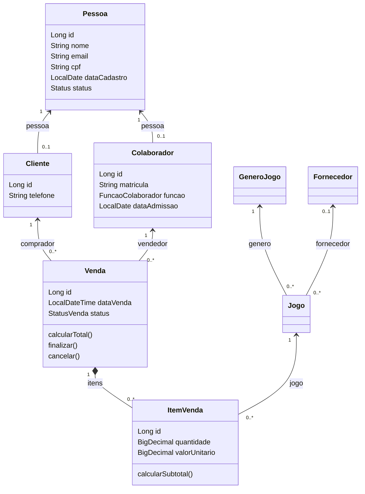
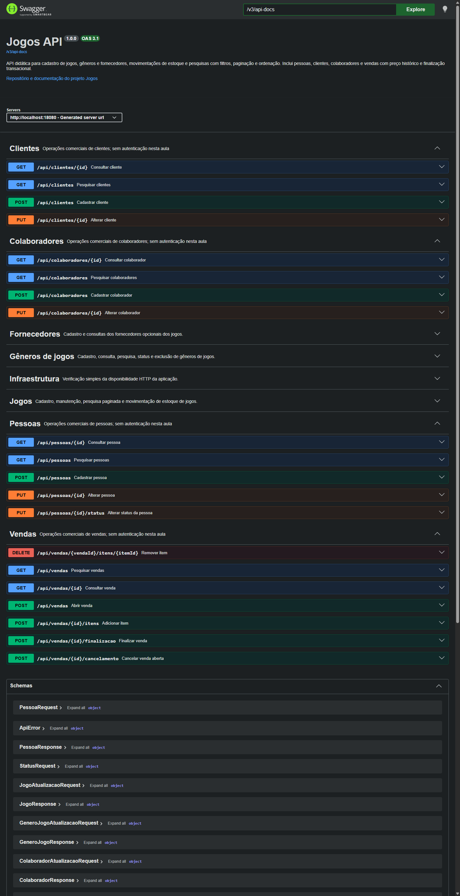

# Aula 10 — Pessoas, papéis e venda de jogos

Fonte integral: https://github.com/jeffersonarpasserini/suporteos2026/blob/main/docs/10aula/10aula.md. Implementação local sobre o commit da Aula 09 96fd68ff7964bc8e351d54c9a097be4110fe3e7e. Sem Git de escrita ou publicação nesta etapa.

## Diagnóstico e decisões

Baseline executada antes das alterações: **85 testes, zero falhas, erros e ignorados**, BUILD SUCCESS (target/aula10-baseline.log). Java 21, Boot 4.0.8, Maven Wrapper, PostgreSQL 17.11, Liquibase e springdoc 3.0.3 foram preservados. O diretório de trabalho estava limpo. Docker não estava ativo, mas o PostgreSQL já estava acessível; não foi necessário trocar configurações nem iniciar outro banco.

GrupoProduto corresponde a GeneroJogo; Produto corresponde a Jogo; descricao a nome; valorUnitario do catálogo a preco; saldoEstoque a unidadesDisponiveis. ItemVenda referencia jogo_id. Nenhuma classe existente foi renomeada. Os pacotes reais controller/dto/mapper/application/domain/repository foram mantidos.

Pessoa é a identidade civil. Cliente e Colaborador são papéis por composição: podem coexistir para a mesma pessoa e não repetem CPF/email. Função é trabalho (VENDEDOR, GERENTE, ESTOQUISTA, ADMINISTRATIVO), não autorização. Herança seria adequada se houvesse uma especialização estável e substituição verdadeira; aqui criaria combinações artificiais ou duplicação. Não há @Inheritance nem extends Pessoa.

## Diagrama atual



ItemVenda é entidade associativa, não @ManyToMany: cada associação possui quantidade, preço histórico, identidade e subtotal. O preço vem do Jogo na inclusão; não pode ser enviado pelo consumidor. Quantidade usa NUMERIC(18,3), preço NUMERIC(18,2), compatíveis com o estoque existente. Subtotais e total usam BigDecimal e HALF_UP com duas casas. Total é derivado, sem coluna redundante. Quantidades fracionárias são mantidas por compatibilidade com a atividade e o estoque já existente; exigir unidades inteiras seria uma decisão futura, não uma regra inventada nesta implementação.

## Documentos fiscais e dados legados

DocumentoFiscal calcula os dois DVs, rejeita repetidos, tamanhos e caracteres indevidos. CPF exige 11 dígitos sem pontuação; CNPJ exige 14. @CpfValido/@CnpjValido aceitam null para deixar obrigatoriedade a @NotBlank; vazio/espaços são inválidos. O domínio verifica novamente. A consistência matemática não prova existência, titularidade ou autorização; os exemplos e dados de teste são didáticos.

Inspeção somente SELECT antes de mudar o esquema: **dev: 2 fornecedores, 2 CNPJs inválidos; test: 12 fornecedores, 12 inválidos**. Esses registros NÃO foram corrigidos, removidos ou recalculados. Continuam consultáveis como legado; novas entradas precisam ser válidas. A migração 005 não adiciona algoritmo fiscal retroativo à tabela fornecedor. Proposta de saneamento: exportar inventário restrito para a responsável, confirmar documentos em fonte legítima, mapear correções por ID com aprovação e backup, auditar duplicidades, então aplicar migração incremental própria. Nunca inventar DVs para transformar uma identidade antiga em outra.

Fixtures antigas que usavam só 14 dígitos passaram a usar CNPJ válido; os testes e suas verificações foram preservados. A coleção anterior mantém 30 pedidos e 43 verificações, alterando somente a geração fiscal. A validação nova rejeita deliberadamente documentos que antes passavam apenas na regex.

## Regras e transação

Venda começa ABERTA. Inclusão/remoção só nesse estado; incluir não baixa estoque. Cliente e vendedor devem estar ativos na abertura/finalização, e vendedor deve ser VENDEDOR ou GERENTE. Jogo precisa estar ativo na inclusão/finalização. Venda vazia não finaliza. Repetir finalização falha antes de uma segunda baixa. CANCELADA e FINALIZADA não reabrem; não há estorno.

VendaService.finalizar coordena tudo em @Transactional: valida estado e participantes, percorre os jogos retirando unidades pelos métodos existentes e marca FINALIZADA. Uma falha desfaz a operação completa. O domínio não contém setters genéricos para contornar essas regras. A remoção de item retorna **204 sem corpo**, adaptação permitida do exemplo com resposta 200.

**Prova de rollback:** VendaServiceTest.rollbackRealDoSegundoItemPreservaAmbosSaldosEVendaAberta prepara e confirma uma venda com dois jogos. No teste, uma transação externa captura a falha do service no segundo jogo, confere rollbackOnly, força flush e lê por JDBC o saldo temporário 8 do primeiro. A conclusão provoca UnexpectedRollbackException; uma nova transação limpa o persistence context e lê saldos 10 e 1 e venda ABERTA. O flush é uma instrumentação do teste, não uma gravação por item acrescentada ao service. Sem a fronteira transacional do service, a verificação rollbackOnly falha. Há também prova HTTP de saldos preservados no Newman.

**Limite:** @Transactional garante atomicidade desta operação, mas duas transações concorrentes podem ler o mesmo saldo e sobrescrever baixas. Não há @Version, lock pessimista ou isolamento adicional nesta aula. Antes de produção, avaliar concorrência com testes específicos e uma estratégia de locking/idempotência de comandos. Não há promessas de prevenção de concorrência nesta entrega.

## Migração 005

Arquivo: src/main/resources/db/changelog/changes/005-pessoas-clientes-vendas.yaml, registrado no master. São **24 changesets novos**, além dos **18 antigos**, sem editar 001–004. Cinco tabelas: pessoa, cliente, colaborador, venda e item_venda. Possui PKs, unicidade de CPF, índice funcional de email normalizado, matrícula e pessoa por papel, par venda/jogo, sete CHECKs e seis FKs. Pessoa/participantes/jogo usam RESTRICT; venda → item usa CASCADE. Jogo vendido não pode ser excluído fisicamente: API retorna 409. Inativar preserva histórico.

Cada changeset tem rollback definido. MigracaoComercialTest aplica todo o master em schema isolado limpo e aplica 005 após 001–004 em outro schema do jogos_test, preservando fornecedor legado inválido. Somente esses schemas temporários próprios são descartados pelo teste; nunca são revertidas migrações do schema real ou de dev/prod. ddl-auto=validate e open-in-view=false continuam ativos.

## REST: 20 operações novas

| Método | Caminho | Objetivo | Sucesso | Erros | Evidência no OpenAPI |
|---|---|---|---|---|---|
| GET | `/api/pessoas/{id}` | Consultar pessoa | 200 | 400, 404 | `consultarPessoa` |
| PUT | `/api/pessoas/{id}` | Alterar pessoa | 200 | 400, 404, 409 | `alterarPessoa` |
| PUT | `/api/pessoas/{id}/status` | Alterar status da pessoa | 200 | 400, 404 | `alterarStatusPessoa` |
| GET | `/api/colaboradores/{id}` | Consultar colaborador | 200 | 400, 404 | `consultarColaborador` |
| PUT | `/api/colaboradores/{id}` | Alterar colaborador | 200 | 400, 404, 409 | `alterarColaborador` |
| GET | `/api/clientes/{id}` | Consultar cliente | 200 | 400, 404 | `consultarCliente` |
| PUT | `/api/clientes/{id}` | Alterar cliente | 200 | 400, 404 | `alterarCliente` |
| GET | `/api/vendas` | Pesquisar vendas | 200 | 400 | `pesquisarVendas` |
| POST | `/api/vendas` | Abrir venda | 201 | 400, 404 | `abrirVenda` |
| POST | `/api/vendas/{id}/itens` | Adicionar item | 200 | 400, 404, 409 | `adicionarItemVenda` |
| POST | `/api/vendas/{id}/finalizacao` | Finalizar venda | 200 | 400, 404 | `finalizarVenda` |
| POST | `/api/vendas/{id}/cancelamento` | Cancelar venda aberta | 200 | 400, 404 | `cancelarVenda` |
| GET | `/api/pessoas` | Pesquisar pessoas | 200 | 400 | `pesquisarPessoas` |
| POST | `/api/pessoas` | Cadastrar pessoa | 201 | 400, 409 | `cadastrarPessoa` |
| GET | `/api/colaboradores` | Pesquisar colaboradores | 200 | 400 | `pesquisarColaboradores` |
| POST | `/api/colaboradores` | Cadastrar colaborador | 201 | 400, 404, 409 | `cadastrarColaborador` |
| GET | `/api/clientes` | Pesquisar clientes | 200 | 400 | `pesquisarClientes` |
| POST | `/api/clientes` | Cadastrar cliente | 201 | 400, 404, 409 | `cadastrarCliente` |
| GET | `/api/vendas/{id}` | Consultar venda | 200 | 400, 404 | `consultarVenda` |
| DELETE | `/api/vendas/{vendaId}/itens/{itemId}` | Remover item | 204 | 400, 404 | `removerItemVenda` |

Criações de pessoa, cliente, colaborador e venda retornam 201 com Location. Inclusão de item é comando com 200; não aceita preço enviado pelo cliente. Atualizações/consultas/comandos retornam 200; exclusão do item retorna 204 vazio. IllegalStateException comercial agora é 400 no ApiExceptionHandler existente. Duplicidades e conflitos de integridade são 409; ausência de recurso/referência é 404. ApiError mantém exatamente timestamp/status/error/message/path/fields. Exemplos em português podem depender de Accept-Language: pt-BR para mensagens padrão de Bean Validation.

## Filtros, paginação e eficiência

Pessoas: nome/status; ordenar id,nome,email,cpf,dataCadastro,status. Clientes: nome/status/pessoaId; ordenar id,telefone. Colaboradores: nome/status/pessoaId/funcao; ordenar id,matricula,funcao,dataAdmissao. Vendas: status/clienteId/vendedorId/dataInicial/dataFinal; ordenar id,dataVenda,status. Filtros são combináveis em Specifications. Intervalo invertido é 400; data final inclui todo o dia por comparação menor que o início do seguinte.

Todas as páginas usam page iniciado em zero, size padrão 20 e máximo 100, sort=campo,asc ou campo,desc repetível; valores inválidos geram 400. PaginaResponse mantém conteudo,pagina,tamanho,totalElementos,totalPaginas,primeira,ultima. VendaResumoResponse não carrega itens nem calcula total. Venda detalhada usa EntityGraph dos participantes/pessoas/itens.jogo. O teste de eficiência confirma coleção não carregada, zero collection fetch e no máximo duas consultas na página com contagem.

Exemplo: GET /api/vendas?status=FINALIZADA&clienteId=ID_CAPTURADO&dataInicial=2026-11-01&dataFinal=2026-11-30&page=0&size=5&sort=dataVenda,desc. Substituir o ID dinamicamente; não presumir 1.

## Execução segura, OpenAPI e Postman

```powershell
.\mvnw.cmd -DskipTests compile
.\mvnw.cmd test
.\mvnw.cmd spring-boot:run '-Dspring-boot.run.profiles=test' '-Dspring-boot.run.arguments=--server.port=18080 --spring.config.additional-location=file:./src/test/resources/'
node scripts/aula10-exportar-contrato.cjs
node --test scripts/aula09-schema-validator.test.cjs
npm.cmd exec --yes --package=newman -- newman run postman/Jogos-Aula10.postman_collection.json --env-var baseUrl=http://localhost:18080 --reporters cli,json --reporter-json-export target/aula10-newman.json
```

Configurar localmente DB_TEST conforme .env.example. Nunca executar a coleção em dev/prod: ela cria fixtures e faz exclusões das próprias fixtures antigas. As vendas da Aula10 ficam como histórico no banco de testes. Nenhuma credencial é exportada. Docker não é exigido se o PostgreSQL já estiver disponível.

Swagger UI: http://localhost:18080/swagger-ui.html; JSON: /v3/api-docs; YAML: /v3/api-docs.yaml. Dev/test habilitados; prod desabilitado, verificado sem banco de produção. O contrato real da Aula10 tem **38 operações, 24 caminhos, 30 schemas e oito tags**, incluindo Pessoas, Clientes, Colaboradores e Vendas. Arquivo [aula-10-openapi.yaml](aula-10-openapi.yaml). O contrato e as imagens da Aula09 foram preservados; o exportador antigo interrompe se a API não tiver as 18 operações da sua versão, evitando sobrescrita histórica silenciosa.



A captura foi produzida em Chrome headless com 38 operações efetivamente renderizadas. As tags anteriores foram recolhidas por clique na interface para destacar as quatro novas; nenhum Try it out foi usado nessa captura. O laboratório comercial foi executado por HTTP/Newman, não é apresentado como execução visual manual das vendas. Para repetir a captura, iniciar Chrome isolado com --headless=new --remote-debugging-port=9222 --user-data-dir=CAMINHO_ABSOLUTO_EM_TARGET e executar scripts/aula10-swagger-evidencia.cjs.

## Atividade orientada: resultados reais e síntese

[JSONs essenciais](aula-10-evidencias-http.json), extraídos diretamente do Newman: A inicia saldo10/preço100; B saldo10/preço50; quantidades 2 e 3. O preço atual de A muda para120. A consulta mantém valorUnitario100, subtotal200 e total350 (200+150). Finalização200 deixa saldos8/7; remover item finalizado retorna400 com Somente vendas abertas podem ser alteradas. O exemplo isolado obrigatório 100 × 2 = 200, mesmo após preço120, também é comprovado em VendaServiceTest e VendaTest.

1. ABERTA aceita itens sem retirar estoque.
2. O item registra snapshot do preço, não uma consulta ao preço futuro.
3. Duas unidades de A mantêm subtotal200 após alterar seu catálogo para120.
4. O segundo jogo acrescenta150, totalizando350 no cenário com dois itens.
5. Finalizar valida todos e baixa as quantidades em uma transação.
6. A insuficiência no segundo jogo não deixa baixa parcial confirmada.
7. FINALIZADA impede remover itens ou repetir a finalização, retornando400.
8. Atomicidade não elimina a limitação de concorrência documentada.

## Segurança futura e comunicação

ContaAcesso poderia ter uma FK única para Pessoa (Pessoa 1 → 0..1 ContaAcesso) e relacionar perfis/permissões em outro ciclo de vida. Identidade e papéis continuariam existindo sem conta. Futuramente tratar hash via PasswordEncoder, login único, bloqueio, menor privilégio, auditoria e proteção dos documentos. Função GERENTE não concede autorização. Não foram implementados ContaAcesso, senha, login, JWT, autenticação, autorização, estorno ou locking.

A API não registra manualmente documentos completos em mensagens de erro; a validação matemática não consulta cadastro externo. Em produção futura, revisar também a política de logs da infraestrutura e do banco, além da autenticação e minimização de dados. Testes/logs ficam somente em target; exemplos são didáticos. A revisão da apresentação/atividade em dupla permanece pendente de participação humana; não foi simulada. Nenhum commit, push ou tag foi feito nesta aula.

## Doze questões de revisão

1. Cliente extends Pessoa torna papéis simultâneos artificiais e pode duplicar identidade; composição resolve isso.
2. Herança serve a uma abstração estável com subtipos substituíveis, como uma hierarquia de estratégias com contrato comum; não a papéis acumuláveis.
3. Função descreve trabalho; permissão decide acesso. Uma pessoa pode ser gerente sem conta ou ter conta bloqueada.
4. ItemVenda possui identidade e atributos da associação: quantidade, preço e subtotal; uma lista direta de jogos perderia isso.
5. Consultar sempre o preço atual reescreveria o valor econômico de vendas antigas.
6. Formato confirma dígitos/tamanho; DV confirma consistência pelo algoritmo, rejeitando também repetidos.
7. Não. CPF matematicamente válido não prova existência nem titularidade.
8. Abertura/inclusão ainda são rascunho; a confirmação comercial acontece na finalização. Reserva de estoque seria outra regra, não implementada.
9. A exceção de negócio sai da fronteira transacional e desfaz todos os efeitos; a prova consulta PostgreSQL em nova transação.
10. Resumo evita buscar coleções durante paginação, reduz N+1 e mantém contagem correta.
11. Duas transações podem ler o mesmo saldo e disputar baixas; @Transactional sozinho não resolve atualização perdida.
12. Conta deve referenciar Pessoa, identidade única independente de Cliente/Colaborador; credenciais têm ciclo de vida separado.

Resultados e checklist completo: [evidências](aula-10-evidencias.md) e [auditoria](aula-10-auditoria.md).

## Correções após auditoria independente

[Relatório das seis correções](aula-10-correcoes-auditoria.md), com 161 testes Maven, 11 Node e Newman 81/135 aprovados. O contrato novo foi reexportado; o da Aula 09 permanece histórico. Schemas obrigatórios compartilham a semântica Unicode de String.isBlank. Logs JDBC preservam apenas metadados seguros; a impressão direta de SQL em dev está desabilitada para não contornar o filtro. A atividade humana continua NÃO VERIFICADA.

## Validação final de campos normalizados

Valores obrigatórios são conferidos antes e depois de trim; NBSP mantém a semântica anterior. O limite de e-mail é revalidado após minúsculas Unicode. [Relatório atual de testes e limites](aula-10-validacao-textos.md):176 testes Maven,12 Node e Newman: 81 requisições/135 verificações aprovados;253 chamadas HTTP de fronteira executadas. A proteção impede novas gravações inválidas, sem saneamento automático de registros antigos.

## Ajuste posterior do padrão OpenAPI Unicode

[Correção pontual e resultados atuais](aula-10-openapi-unicode.md): padrão alinhado à ordem real de trim/isBlank, sem alterar entidades. Foram comparadas 5.539 entradas no Java e ECMAScript, com padrões reais de nove campos. Maven: 178 testes e Node: 14 testes aprovados; Newman: 81 requisições/135 verificações sem falhas. A atividade humana continua NÃO VERIFICADA.
