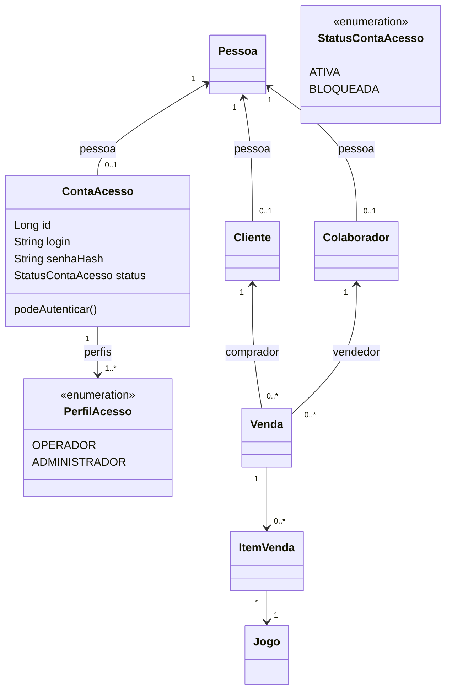
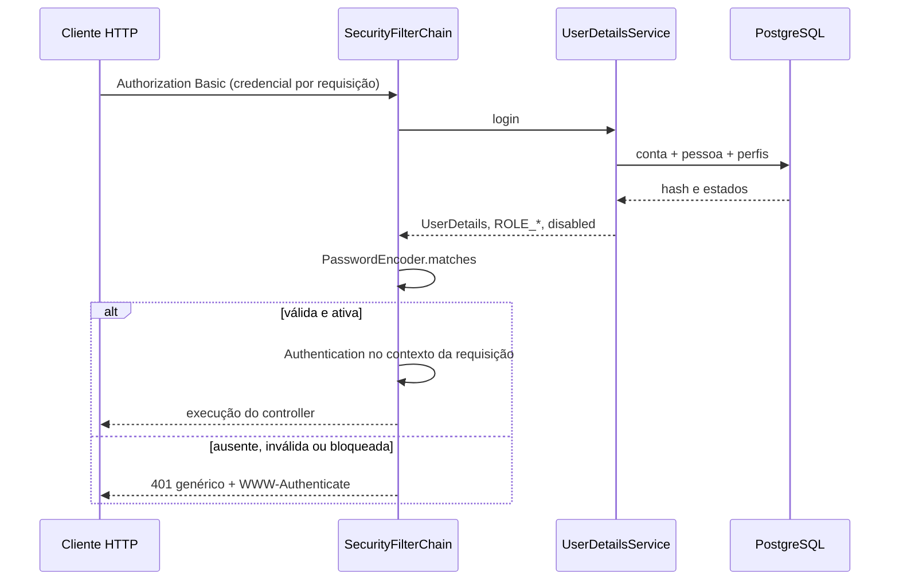

# Aula 12 — Autenticação da Jogos API

Referência integral: [atividade oficial](https://github.com/jeffersonarpasserini/suporteos2026/blob/main/docs/12aula/12aula.md). Marco inicial: main, `56ce7361da8f8f384c1f51125254b7a424ec8859`, Aula 11 publicada. A implementação da Aula 12 permanece local.

## Diagnóstico e decisões

Projeto inspecionado antes da alteração: Java21, Spring Boot4.0.8, PostgreSQL17.11, Hibernate7.2.24.Final, Liquibase5.0.3, springdoc3.0.3. Árvore inicial limpa, origin Siunne/Jogos. A baseline executada registrou 198 testes Maven, 14 Node e Newman81 requisições/135 verificações, sem falhas. Relatórios temporários `target/aula12-baseline-*`.

Pessoa já representa a identidade civil com CPF/e-mail e status ATIVO/INATIVO. Cliente e Colaborador são papéis compostos; a função de vendedor não concede permissão de software. Nenhuma senha foi adicionada a essas entidades. Os services de estoque e vendas e sua política de locking foram preservados.

Identificação é informar um login. Autenticação verifica a credencial. Autorização decide quais ações a identidade pode executar. Nesta aula, OPERADOR e ADMINISTRADOR têm o mesmo acesso autenticado; não há controle diferenciado por perfil. ADMINISTRADOR não é sinônimo de GERENTE ou outra função profissional.

## Diagrama



senhaHash no diagrama é exclusivamente persistência; nunca integra a resposta HTTP. ContaAcesso é unidirecional para Pessoa, sem herança, com uma conta por Pessoa e perfis como ElementCollection. Conta nasce ATIVA e exclusivamente OPERADOR. Conta bloqueada ou Pessoa INATIVO não autentica.

## Dependências e pontos de quebra

O POM utiliza versões gerenciadas pelo Spring Boot: starter-security, spring-security-test (test) e starter-security-test (test). O terceiro fornece a integração modular de MockMvc e WithMockUser do Boot4; não adiciona autenticação à produção. A necessidade está no [guia oficial de migração do Boot4](https://github.com/spring-projects/spring-boot/wiki/Spring-Boot-4.0-Migration-Guide). Não foram atualizados Boot, Java ou springdoc.

1. Dependências: compilação executada com Wrapper e BOM existente.
2. Banco: migração006 com unicidade, FKs, CHECKs e rollback, testada em schemas isolados.
3. Conta persistida: testes verificam prefixo BCrypt, matches e ausência do texto aberto.
4. API protegida: filtros ativos, Basic válido, 401 anônimo/bloqueado e contrato documentado.

## Login e normalização

Após remover **somente U+0020 nas extremidades**, o login deve conter de3 a80 caracteres ASCII: letras, números, ponto, hífen ou sublinhado. Java usa Locale.ROOT para minúsculas. Tabs, quebras de linha, NBSP, espaços internos e letras acentuadas são rejeitados; não se usa trim(), pois ele removeria controles que BTRIM não remove.

O índice solicitado é `LOWER(BTRIM(login))`. O repository consulta a mesma expressão, e o service persiste o valor canônico. Testes comparam Java, Bean Validation, regex efetivamente servida e PostgreSQL, incluindo I maiúsculo e limites de tamanho no ambiente real. Se o banco mudar de locale/collation, essa equivalência deve ser revalidada. Cadastro com login equivalente retorna409, inclusive caixa e espaços externos. A constraint continua protegendo corridas entre cadastros.

O OpenAPI documenta o limite do valor normalizado por pattern, sem impor um maxLength incorreto ao texto bruto que ainda contém espaços externos. O request possui apenas pessoaId/login/senha; campos extras de perfis/status não são usados. O teste envia ADMINISTRADOR e BLOQUEADA e confirma resposta e persistência ATIVA/OPERADOR.

## Senhas, BCrypt e privacidade

PasswordEncoderFactories.createDelegatingPasswordEncoder() produz BCrypt com prefixo `{bcrypt}`. BCrypt inclui salt aleatório e custo de trabalho: senhas iguais produzem hashes diferentes. O custo padrão da biblioteca é mantido, sem redução para acelerar testes. Hash é unidirecional, não criptografia reversível.

A política exige pelo menos12 **pontos de código Unicode**, não apenas unidades UTF-16, no máximo72 bytes UTF-8 e Unicode bem formado. U+0000 é proibido em qualquer posição. A senha não sofre trim nem conversão de caixa. A política é aplicada em Bean Validation, no service antes de encode e no adaptador de PasswordEncoder também durante matches do Basic. Assim uma credencial acima de72 bytes é rejeitada com401, sem truncamento nem erro500 do encoder. Exemplos de fronteira nos testes: 36 caracteres de dois bytes aceitos,37 rejeitados;12 emojis aceitos, seis não atingem o mínimo.

Troca de senha exige Basic válido e senha atual correta; nova senha deve cumprir a política e ser diferente. A comparação usa matches; nunca equals(encode()). O novo hash é persistido transacionalmente. Senha antiga deixa de autenticar após commit, nova funciona e requisição sem credencial continua401. Não existe sessão de login para continuar autenticada após a mudança.

No OpenAPI, minLength/maxLength descrevem caracteres, não bytes UTF-8. O pattern dos três campos de senha rejeita U+0000 e preserva os demais caracteres. O teto de72 bytes está explícito nas descrições e é comprovado na aplicação; não se promete equivalência integral dessa regra apenas com JSON Schema ou com o validador parcial Node.

DTOs de senha têm toString redigido e schemas writeOnly/password; ContaAcesso também omite credenciais no toString e ignora hash na serialização. Controllers retornam DTOs públicos, nunca entidades. Logs JDBC continuam filtrados; os diagnósticos do namespace Spring Security são bloqueados para evitar emissão de headers ou credenciais mesmo com TRACE. O filtro preserva SQLState e nomes conhecidos de constraints, sem parâmetros, linhas rejeitadas ou stack traces JDBC. Essa política reduz diagnóstico textual de segurança; futura observabilidade deve usar eventos estruturados sem segredos.

Nenhuma senha fixa de administrador, conta de produção ou credencial real foi criada. Testes e Postman geram credenciais fictícias por execução. O executor Newman captura o resultado em memória, sanitiza senhas e Authorization **antes** da escrita e salva somente o relatório sanitizado em target. Não grave relatórios brutos do Newman com credenciais reais. O prefixo do algoritmo é documentado; valores reais de hashes não são incluídos nas evidências.

## Liquibase006 e integridade

Arquivo `src/main/resources/db/changelog/changes/006-contas-acesso.yaml`, incluído no master. Sete changesets, total **49 =42 anteriores +7**, diferente dos33 do exemplo do professor. Os arquivos001–005 não foram editados.

| Recurso | Restrição |
|---|---|
| conta_acesso.id | PK identity |
| pessoa_id | NOT NULL, UNIQUE e FK para Pessoa, ON DELETE RESTRICT |
| login | NOT NULL, VARCHAR80, índice único LOWER(BTRIM(login)), CHECK de caracteres/tamanho normalizado |
| senha_hash | NOT NULL, VARCHAR255, CHECK de formato BCrypt prefixado |
| status | NOT NULL, ATIVA/BLOQUEADA |
| conta_acesso_perfil | PK composta conta_acesso_id/perfil, CHECK OPERADOR/ADMINISTRADOR |
| conta dos perfis | FK ON DELETE CASCADE: apagar conta remove somente seus perfis |

Cada changeset possui rollback. Na reversão da006, as restrições são removidas antes das tabelas e a tabela dependente antes da conta. A prova de rollback foi executada somente em schema temporário próprio de jogos_test: conserva42 changesets e Pessoas preexistentes. A aplicação não executou rollback em public ou em qualquer banco de desenvolvimento/produção. Testes SQL verificam SQLStates e nomes concretos das constraints.

## Spring Security e fluxo



UserDetailsService usa EntityGraph para Pessoa e perfis, dentro de transação readOnly. As autoridades são ROLE_OPERADOR e ROLE_ADMINISTRADOR, sem hasRole/hasAuthority diferenciando permissões. O filtro de Basic consulta o banco a cada requisição; não há login de formulário, logout de sessão, request cache ou JWT.

SessionCreationPolicy.STATELESS impede que a identidade seja mantida em HttpSession. CSRF foi desabilitado para o contrato didático de clientes de API que fornecem Authorization explicitamente, sem cookie de autenticação. **Stateless sozinho não elimina CSRF:** navegadores podem reenviar Basic armazenado automaticamente. Para um cliente web em produção, essa decisão deve ser reavaliada antes da exposição. Swagger é uma ferramenta local de estudo, não evidência de segurança de produção.

HTTP Basic codifica login/senha em Base64, não cifra. Fora do laboratório local, requer HTTPS/TLS para impedir interceptação. Não compartilhe capturas de Authorization ou comandos com credenciais reais.

## Rotas e códigos

Públicas: GET `/api/health`, `/v3/api-docs`, `/v3/api-docs.yaml`, `/v3/api-docs/**`, `/swagger-ui.html`, `/swagger-ui/**`; POST `/api/pessoas` e `/api/contas-acesso`. Os matchers usam métodos explícitos. Demais rotas exigem autenticação. Um header Basic inválido é rejeitado mesmo se enviado desnecessariamente a uma rota pública.

| Método e rota nova | Entrada | Sucesso | Erros previstos |
|---|---|---|---|
| POST /api/contas-acesso | pessoaId, login, senha |201; Location `/api/contas-acesso/me` |400 validação/Pessoa inativa;404 Pessoa ausente;409 login/pessoa duplicados |
| GET /api/contas-acesso/me | Basic |200 ContaAcessoResponse |401 |
| PUT /api/contas-acesso/me/senha | Basic + senhaAtual/novaSenha |204 sem corpo |400 inválida, atual incorreta ou repetida;401 |

O Location do cadastro aponta para a consulta da própria conta e exige Basic; não foi inventada consulta pública de conta por ID. Resposta pública possui id, pessoaId, nomePessoa, login, status e perfis, sem senha/hash. Os erros de negócio400/404/409 usam ApiError existente. O401 dos filtros tem contrato próprio mínimo `{"status":401,"message":"Autenticação necessária ou credenciais inválidas"}`, sem distinguir usuário inexistente, senha incorreta ou bloqueio, acompanhado do desafio WWW-Authenticate. Não se promete ApiError para401/403; padronização completa é evolução futura do professor.

As38 operações anteriores são preservadas, agora com autenticação conforme o contrato. A API completa tem41 operações,27 caminhos,34 schemas e nove tags; `basicAuth` é HTTP Basic e as três operações públicas de negócio têm security vazio. O contrato inclui401 nas operações protegidas e exemplos de erros coerentes com os handlers. Um cadeado no Swagger documenta, mas são os filtros que protegem efetivamente.

## Executar com segurança

Configure `.env` local ignorado ou ambiente externo com DB_TEST_URL/DB_TEST_USERNAME/DB_TEST_PASSWORD para **jogos_test**. Não exporte valores reais. Não é necessário alterar ddl-auto, isolamento ou OSIV. Nenhum comando abaixo deve apontar para banco real de desenvolvimento/produção.

```powershell
.\mvnw.cmd -DskipTests compile
.\mvnw.cmd test
.\mvnw.cmd spring-boot:run '-Dspring-boot.run.profiles=test' '-Dspring-boot.run.arguments=--server.port=18080 --spring.config.additional-location=file:src/test/resources/application-test.properties'
# Em outro terminal, confirme jogos_test no log JDBC antes de escrever:
node scripts/aula12-exportar-contrato.cjs
$env:AULA12_BANCO_TESTE_CONFIRMADO='jogos_test'
npm.cmd exec --offline --package=newman -- node scripts/aula12-newman.cjs
node scripts/aula12-conferir-newman.cjs
node --test scripts/aula09-schema-validator.test.cjs scripts/aula10-contrato-gerador.test.cjs scripts/aula10-unicode-equivalencia.test.cjs scripts/aula12-seguranca.test.cjs
git diff --check
```

Newman precisa estar no cache npm para usar offline. O runner não é um substituto de Newman: carrega e executa a biblioteca Newman real. Não usar exportação JSON bruta com credenciais. A coleção `postman/Jogos-Aula12.postman_collection.json` conserva as81 requisições anteriores, usa Basic na raiz com authLogin/authPassword e gera valores fictícios novos no bootstrap. Cada execução cria registros próprios no banco de testes; não presume IDs iniciando em1.

Swagger na porta18080: `/swagger-ui.html`; JSON `/v3/api-docs`; YAML `/v3/api-docs.yaml`. Para ensaio visual, crie Pessoa e conta, clique Authorize, informe somente credenciais fictícias, consulte `/me`, retire a autorização e confirme401 em `/api/jogos`. O preenchimento manual do diálogo e o fluxo visual completo após logout ainda dependem de conferência manual. JSON/YAML/UI foram verificados por HTTP e testes. A documentação continua habilitada em dev/test e bloqueada em prod; a prova de profiles não usa DataSource de produção.

Também foi executada uma chamada real pela interface Swagger UI em Chrome headless isolado: AuthActions autorizou Basic e Try it out/Execute retornou200 em `/me`. A [captura](evidencias/aula-12-swagger-autenticado.png) mostra a resposta, com o trecho curl de Authorization ocultado por CSS antes de capturar. Não foi uma digitação manual no diálogo. A retirada da autorização foi conferida no estado da UI e uma chamada HTTP independente retornou401; **a renderização visual do401 após logout não foi comprovada** e permanece pendente de conferência manual. O script `scripts/aula12-swagger-ui.cjs` requer Chrome headless isolado na porta9232 e a confirmação de jogos_test, sem credenciais em argumentos de processo.

Se receber401, verifique credenciais, estados de conta/Pessoa e header Basic sem registrar seus valores. Se aparecer erro de encoder, confira o prefixo e o uso do PasswordEncoder. Problemas Liquibase devem ser diagnosticados pelos changesets/SQLState; não editar changesets aplicados. As cópias históricas dos contratos09/10/11 permanecem preservadas; a entrega atual é [aula-12-openapi.yaml](aula-12-openapi.yaml).

## Atividade de transferência — nove itens

1. **Identidade:** Pessoa já concentra os dados civis da pessoa que compra ou trabalha na loja.
2. **Conta separada:** um cliente pode ter acesso sem ser colaborador; um colaborador pode existir sem credencial. ContaAcesso não herda nem duplica CPF/e-mail.
3. **Dois perfis:** OPERADOR e ADMINISTRADOR representam acesso futuro ao sistema, não capacidade comercial de vender. Nesta aula ambos têm acesso autenticado igual.
4. **Somente hash:** consulta JDBC, matches e teste de salt comprovam BCrypt; respostas, serialização e logs não expõem a credencial.
5. **Bootstrap:** Pessoa e conta públicas iniciam o banco, gerando somente OPERADOR. Isso não verifica titularidade da Pessoa e não é adequado para produção.
6. **Rota protegida:** GET `/api/jogos` exige Basic, mantendo filtros e PaginaResponse anteriores.
7. **Acessos:** testes verificam401 anônimo,200 com conta válida e401 com conta bloqueada/Pessoa inativa; Newman comprova os fluxos HTTP reais.
8. **Diagrama:** a composição atualizada está no início deste guia.
9. **Três ameaças pendentes:** força bruta sem limitação/MFA; apropriação de identidade no bootstrap sem convite/verificação; interceptação de Basic se exposto sem TLS. Adicionalmente, cliente navegador exige análise de CSRF.

## Limitações

Não há JWT/OAuth2, login social, recuperação de senha, MFA, expiração de credenciais, rate limiting, auditoria de identidade ou autorização diferenciada. O cadastro público não é provisionamento seguro: em produção exige controles administrativos ou convite, titularidade, limitação e auditoria. CSRF/HTTPS devem ser reavaliados para o cliente real. A geração OpenAPI e o validador parcial Node não substituem revisão humana ou certificam integralmente a especificação. Os testes não provam ausência universal de vazamentos sob futuras configurações.

Resultados reais: [evidências](aula-12-evidencias.md). Questões: [dez respostas](aula-12-questoes.md). Entrega: [auditoria](aula-12-auditoria.md) e [inventário](aula-12-arquivos.md). Não houve staging, commit, tag ou envio ao GitHub nesta aula.

A [correção de segurança U+0000](aula-12-correcao-nul.md) explica a causa cíclica no BCrypt, os testes reais e os resultados antes/depois. A política compartilhada protege cadastro, troca e autenticação, sem modificar migrações ou o algoritmo.
