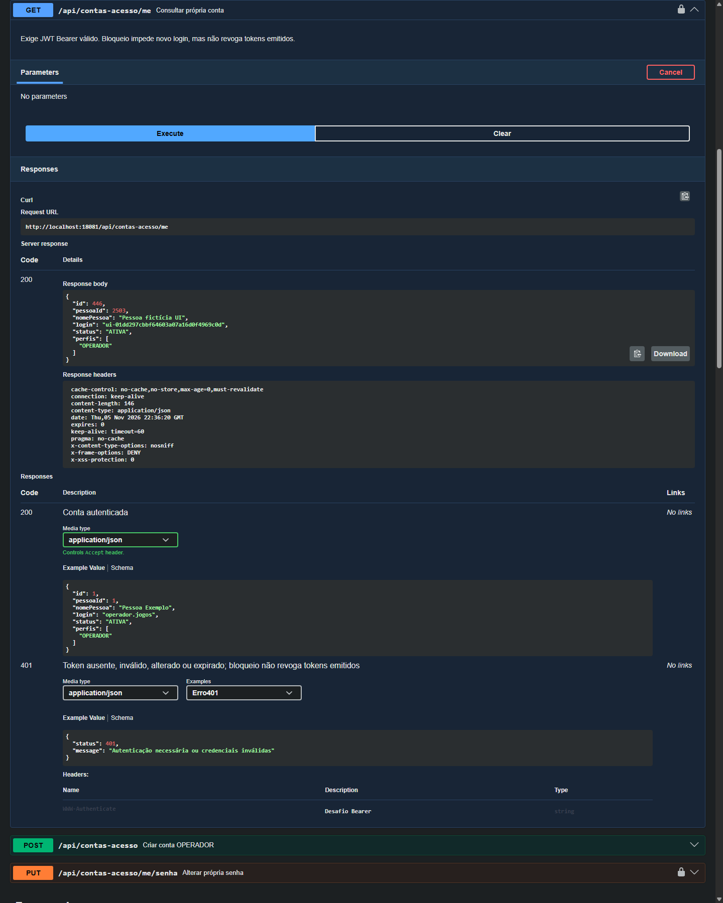

# Aula 13 — Evidências reais

Execuções locais em05/11/2026. Persistência utilizada exclusivamente em jogos_test. Resultados de rodadas intermediárias com falhas foram mantidos em target para diagnóstico, sem apresentação como aprovações finais.

## Ponto inicial

Branch main, HEAD400063010adbd7a8b87d2c93f15a2abe5bd85811, origin=https://github.com/Siunne/Jogos.git. Diretório inicialmente limpo. Baseline executada antes da implementação:

| Verificação | Resultado observado | Artefato temporário |
|---|---|---|
| Maven completo | 254 testes; zero falhas/erros/ignorados | target/aula13-baseline-maven.log |
| Node | 19 aprovados | target/aula13-baseline-node.log |
| Newman real Aula12 | 94 requisições, 239 assertions, zero falhas | target/aula13-baseline-newman.log |
| Aplicação test | Iniciou na porta18081 | target/aula13-baseline-app.log |

## Resultado da implementação antes da correção de claims (histórico)

| Verificação | Resultado | Artefato temporário |
|---|---|---|
| Maven completo após as últimas alterações | 290 aprovados; zero falhas, erros ou ignorados | target/aula13-maven-verificado.log; Surefire XML |
| Classes anteriores | 31 classes e254 execuções preservadas; nenhuma redução na contagem por classe | Baseline comparada com Surefire final |
| Novos testes Maven | 30 execuções JwtSecurityTest e6 JwtConfigurationTest | Surefire XML |
| Node completo | 27 aprovados; zero falhas ou ignorados | target/aula13-node-verificado-final.log |
| Newman real | 98 requisições,250 verificações; zero falhas | target/aula13-newman-verificado.log; relatório JSON sanitizado |
| Contrato versus respostas Newman | 98 respostas e42 operações verificadas no subconjunto declarado | aula13-conferir-newman.cjs |
| Concorrência PostgreSQL | 19 execuções aprovadas, dentro do Maven completo | ConcorrenciaEstoqueTest |
| Privacidade | 11 provas anteriores preservadas e2 cenários JWT com captura de logs | Testes de filtro, integração, conta e JWT |
| Git diff --check | Código0, sem erros de whitespace | target/aula13-diff-check.json |

O último ajuste de schema reutiliza a classe explícita de whitespace Java já adotada no projeto: login/senha em branco são rejeitados pelo contrato servido e pelo HTTP400, enquanto U+00A0 continua permitido como caractere não branco. A senha também proíbe NUL. O limite de72 bytes UTF-8 continua sendo validado semanticamente no encoder, não prometido como equivalência integral de uma regex. Nenhuma regra de domínio foi alterada.

## Correção dos claims — regressão demonstrada

Na auditoria independente, JWTs assinados com a fixture de testes e `nbf: 1e300` ou sub numérico passaram pelo filtro de autenticação. O primeiro chegou a ser convertido para1969-12-31T23:59:59Z. A correção está no decoder composto, antes da conversão, sem alteração do filtro HTTP ou do banco.

Antes da correção, a nova bateria executou79 testes da classe JwtSecurityTest e apresentou dez falhas esperadas, sem erros de execução: seis casos temporais, dois pares extremos de iat/exp e dois subjects numéricos. Os pares usam deslocamentos de ±2^61 segundos, que podiam desaparecer na multiplicação de segundos por1000, produzindo datas aparentemente atuais. No endpoint /me, subjects0/123 alcançavam o controller e resultavam400/404; a reprodução original em /jogos retornava200. Agora todos são barrados com401 no filtro.

Uma segunda rodada controlada demonstrou três falhas por truncamento de frações: iat/nbf meio segundo no futuro e prazo de1800.5 segundos eram tratados como inteiros. A comparação dos valores originais também resolveu esses casos. Os logs das fases anteriores permanecem em target/correcao13-red.log e target/correcao13-fracoes-red.log; são falhas reproduzidas deliberadamente, não resultados finais aprovados.

Após a correção completa, a suíte Maven real executou **346 testes, com zero falhas, erros ou ignorados** (target/correcao13-maven-verificado.log). São as290 execuções anteriores mais56 novas:36 combinações de tipo/faixa temporal, dois pares coordenados, sete tipos inválidos de sub, aceitação de valores válidos, nbf futuro, HS384/HS512, privacidade e seis frações sob Clock controlado. Permanecem incluídas as19 execuções de concorrência PostgreSQL, rollback real, preço histórico, estoque, documentos e política de senha contra U+0000.

O teste de privacidade novo usa um marcador fictício no payload inválido e confirma que resposta/logs não contêm marcador, token ou chave. Isso comprova os cenários executados, sem prometer proteção universal contra futuras configurações de logging.

## JWT e HTTP

JwtSecurityTest usa filtros ativos, conta/Pessoa persistidas, JDBC e transações independentes, sem WithMockUser. O relógio é controlado para verificar o limite sem esperar30 minutos. Os testes antigos de regras/controllers com identidade simulada continuam com esse objetivo e não são apresentados como prova de autenticação.

| Situação executada | Resultado |
|---|---|
| Login com conta apta e senha correta | 200, token HS256 com três segmentos |
| Login inexistente, senha errada, bloqueio ou Pessoa inativa | 401 genérico no ApiError |
| U+0000 na senha | 401; hash persistido inalterado em leitura REQUIRES_NEW |
| Campos ausentes | 400 com fields.login e fields.senha |
| Bearer válido em /me | 200 e identidade do sub |
| Basic ou ausência de credencial na rota protegida | 401 com desafio Bearer |
| Assinatura ou payload alterado, chave diferente | 401 |
| Emissor incorreto, HS384, none, token malformado | 401 |
| exp passado, exp ausente, iat/nbf futuro | 401 |
| Uso em iat+1799 e iat+1800 | 200 e401 respectivamente; exp não muda |
| Perfis enviados no JSON de login | Ignorados; conta determina OPERADOR |
| Bloqueio/Pessoa inativa após emissão | Novo login401; token anterior200 |
| Troca válida de senha | 204; senha anterior não obtém token; nova senha obtém; JWT emitido continua válido |

Os testes de configuração verificam ausência, Base64 inválida e chave curta, inclusive falha de inicialização do contexto. Captura de logs verifica ausência de senha, token, chave e hash nos cenários executados. Isso não garante privacidade sob qualquer configuração futura; preserve o filtro de logs e nunca habilite logging de bodies/Authorization no proxy.

## OpenAPI e laboratório visual

O exportador buscou JSON e YAML reais da aplicação. Foram observadas42 operações, 28 caminhos, 36 schemas e dez grupos. O esquema é bearerAuth/http/bearer/JWT, sem basicAuth. JSON, YAML servido e docs/aula-13-openapi.yaml são comparados estruturalmente pelos testes; somente a URL de servidor depende da porta de execução. Os mappings reais são comparados com o conjunto de operações.

O Chrome headless executou login por Try it out/Execute e /me por Bearer, ambos200. Authorize foi acionado pelas AuthActions do Swagger, não pelo preenchimento manual do diálogo. O bloco do login e trechos com token foram retirados do DOM antes da captura. A imagem foi inspecionada:

Script: scripts/aula13-swagger-ui.cjs. Requer Chrome iniciado com CDP em localhost:9233 e perfil isolado em target/aula13-chrome. Resultado sanitizado em target/aula13-swagger-ui.json. Isso comprova a interação automatizada, não participação/apresentação humana. Não foi produzida captura do token ativo.

## Regressões e alcance das verificações

ConcorrenciaEstoqueTest mantém19 execuções PostgreSQL, incluindo disputa por saldo, movimentos manuais, ordem inversa de jogos, timeout e deadlock real. VendaServiceTest confirma rollback após flush e leitura em transação independente, preço histórico e baixa única. Testes de documentos, normalização/Unicode, CRUD, estoque, filtros, paginação, contas e privacidade continuam na suíte completa.

OpenApiProfilesTest verifica disponibilidade documental dev/test e ausência em prod carregando configurações reais, sem DataSource nem conexão de produção. A autenticação real é exercitada separadamente no profile test com filtros ativos.

O validador próprio verifica somente seu subconjunto de JSON Schema. A checagem de98 respostas Newman abrangeu as42 operações; não constitui certificação integral OpenAPI. Assinatura e expiração são comprovadas pelo JwtDecoder e pelos testes HTTP.

O Node histórico Aula12 aceita JOGOS_OPENAPI_JSON/JOGOS_NEWMAN_JSON opcionais para verificar o contrato e relatório atuais em cópia limpa. Todas as assertions foram preservadas. O teste da coleção Basic continua sendo teste do artefato histórico, explicitamente separado da coleção JWT nova.

Migrações001–006, YAMLs históricos09–12, política de senha e classes centrais de estoque/venda foram comparados por SHA-256 com a baseline:21 arquivos conferidos, nenhum alterado. Liquibase permaneceu com49 changesets, nenhum novo; não há migração007. Dados legados de desenvolvimento não foram acessados nem saneados.

Os números finais, contagens por classe e inventário estão também em aula-13-resultados.json e aula-13-arquivos.md. Logs completos, relatórios Newman e perfil do navegador permanecem em target/, ignorado pelo Git. Nenhuma operação de escrita no Git foi executada.

Verificações externas após a correção: Node27 aprovados (target/correcao13-node-verificado.log); Newman real98 requisições/250 assertions, zero falhas (target/correcao13-newman-verificado.log);51 requisições adversariais HTTP adicionais, zero divergências/HTTP500/eco de credenciais (target/correcao13-adversarial.json). O programa adversarial guarda apenas nomes de casos e códigos, sem tokens ou senhas. As assinaturas negativas usam exclusivamente a fixture test conhecida e não demonstram posse da chave de produção.

O JSON servido foi capturado em target/correcao13-openapi.json e comparado com o contrato anterior:42 operações,28 caminhos,36 schemas e dez tags, sem mudança de contrato. YAML servido/entrega foram verificados pela suíte; o arquivo docs/aula-13-openapi.yaml não foi alterado. Swagger HTML respondeu200. Profiles documentais dev/test/prod passaram em contextos sem DataSource; autenticação real e persistência usaram somente jogos_test.

A leitura numérica também foi testada com100 nanossegundos. A fase target/correcao13-precisao-red.log executou seis casos fracionários e reproduziu três falhas por arredondamento para double. Por isso o preflight usa o JsonMapper do WebMVC com BigInteger/BigDecimal, separado do mapper HTTP global, antes de qualquer coerção. Essa rodada é histórica e não constitui resultado final aprovado.

Reexecução final em 16/11/2026, após retomada: Maven346/0/0/0 (33 classes, JwtSecurityTest86); Node27/0; Newman98 requisições,250 verificações e zero falhas; HTTP adversarial51/0/0 respostas500. A primeira tentativa externa começou antes de o servidor concluir a inicialização e falhou por indisponibilidade; foi descartada como evidência de aprovação. As chamadas foram repetidas após Started JogosApplication e os resultados acima são os da repetição concluída. Código-fonte permaneceu inalterado entre a suíte Maven e as verificações externas. JSON/YAML e Swagger responderam200, com contrato sem alterações.
