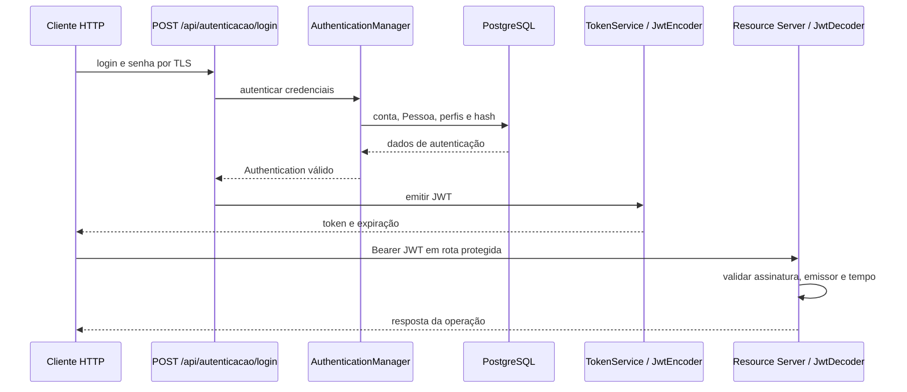

# Aula 13 — JWT no projeto Jogos

Implementação local baseada no [material oficial](https://github.com/jeffersonarpasserini/suporteos2026/blob/main/docs/13aula/13aula.md). O mecanismo de autenticação evolui; as regras comerciais e o locking das aulas anteriores permanecem.

## Executar com segurança

Java21, PostgreSQL, Maven Wrapper e configuração externa são necessários. Boot4.0.8 gerencia o starter OAuth2 Resource Server e suas dependências JOSE. Springdoc permanece3.0.3. Não foi criado filtro JWT manual.

Dev importa `.env` em application-dev.properties; test importa esse arquivo para a conexão jogos_test, mas sobrescreve a chave JWT com fixture conhecida exclusiva de testes. Prod utiliza variáveis da plataforma. A chave local foi gerada com 32 bytes criptograficamente aleatórios, sem impressão do valor. `.env` está ignorado e fora do inventário. `.env.example` contém placeholder inválido.

Em instalação nova, configure a conexão e gere a chave sem exibi-la:

```powershell
if (Select-String -Path .env -Pattern '^JWT_SECRET=' -Quiet) { throw 'JWT_SECRET já configurada; não substituir automaticamente' }
$jwtBytesAula13 = New-Object byte[] 32
$jwtRngAula13 = [System.Security.Cryptography.RandomNumberGenerator]::Create()
try { $jwtRngAula13.GetBytes($jwtBytesAula13) } finally { $jwtRngAula13.Dispose() }
Add-Content -LiteralPath .env -Value ('JWT_SECRET=' + [Convert]::ToBase64String($jwtBytesAula13))
```

Sem chave, com Base64 inválida ou menos de256 bits, o contexto falha sem fallback. JwtProperties oculta o segredo em toString. A chave fictícia do profile test tem69 bytes para também construir o caso negativo HS384; nunca deve ser reutilizada em dev/prod.

Com DB_TEST_URL apontando exclusivamente para jogos_test:

```powershell
.\mvnw.cmd spring-boot:run '-Dspring-boot.run.profiles=test' '-Dspring-boot.run.arguments=--server.port=18081 --spring.config.additional-location=file:src/test/resources/application-test.properties'
```

URLs: http://localhost:18081/swagger-ui.html, /v3/api-docs e /v3/api-docs.yaml. A porta padrão continua8080 fora desse laboratório. Não se conectou a banco dev/prod nas execuções. Para uso local normal, o profile dev utiliza sua própria conexão e JWT_SECRET. Produção exige TLS, segredo próprio e configuração externa.

## Fluxo e responsabilidades



AutenticacaoController recebe LoginRequest; AutenticacaoService reutiliza AuthenticationManager. UserDetailsService e PasswordEncoder já existentes verificam BCrypt e status da conta/Pessoa. Não há comparação duplicada de hashes. TokenService retorna TokenResponse, seguindo a convenção dos services de conta já existentes; não foi necessária uma segunda representação TokenAcesso com os mesmos dados.

Pessoa é identidade civil; Cliente e Colaborador são papéis comerciais; ContaAcesso guarda a credencial e perfis de acesso. Função profissional não representa autorização. OPERADOR/ADMINISTRADOR vêm exclusivamente da conta no servidor e viram autoridades ROLE_*. Não há distinção de permissões nesta aula.

## Contrato HTTP

| Operação | Sucesso | Erros e autenticação |
|---|---|---|
| POST /api/autenticacao/login | 200 TokenResponse | Público; 400 ApiError; 401 ApiError |
| POST /api/pessoas | 201 e Location | Bootstrap público; 400/409 |
| POST /api/contas-acesso | 201 e Location | Bootstrap público somente OPERADOR; 400/404/409 |
| GET /api/contas-acesso/me | 200 ContaAcessoResponse | Bearer; 401 ErroAutenticacao |
| PUT /api/contas-acesso/me/senha | 204 sem corpo | Bearer e senha atual; 400 ApiError, 401 ErroAutenticacao |

O YAML e a matriz enumeram as42 operações completas em28 caminhos, com36 schemas e dez tags. Os endpoints comerciais anteriores permanecem protegidos.

Exemplo de corpo de login, com placeholders não executáveis:

```json
{"login":"LOGIN_DE_LABORATORIO","senha":"SENHA_FICTICIA_DE_LABORATORIO"}
```

A resposta contém accessToken (omitido nas evidências), tokenType=Bearer, expiresIn=1800 e expiresAt em UTC ISO-8601. Login ausente/vazio, tamanho excedido ou JSON inválido recebe400. Credenciais fornecidas mas inválidas recebem401 genérico, incluindo senha fora da política: mínimo12 pontos de código, máximo72 bytes UTF-8, sem U+0000 nem UTF-16 inválido. A senha não sofre trim. @NotBlank trata ausência/espaços no DTO; a política completa é reutilizada pelo encoder durante autenticação. O limite de bytes não é representável integralmente por maxLength do OpenAPI: aparece explicitamente na descrição. Login aceita no máximo80 caracteres no request e usa a normalização ASCII existente.

Erro exemplificativo do login:

```json
{"timestamp":"2026-11-05T12:00:00","status":401,"error":"Unauthorized","message":"Login ou senha inválidos","path":"/api/autenticacao/login","fields":{}}
```

Na rota protegida, o filtro responde `{"status":401,"message":"Autenticação necessária ou credenciais inválidas"}` com desafio WWW-Authenticate Bearer. Esse é ErroAutenticacao, distinto do ApiError do login. /me usa Principal.getName(), que no JwtAuthenticationToken corresponde a sub.

Health, OpenAPI e recursos Swagger permanecem públicos. Somente os três POSTs de bootstrap/login são públicos nas rotas de negócio. Basic não libera rotas protegidas. Um header inválido pode ser rejeitado até numa rota pública; use No Auth no bootstrap/login. Não há form login, sessão, request cache ou logout de servidor. CSRF fica desabilitado nesta API com credencial no header e sem cookie de autenticação; um futuro cliente com cookies exigirá revisão.

## Claims e criptografia

JWT assinado tem header, payload e assinatura. Base64URL codifica; não criptografa. HMAC-SHA256 protege integridade e autenticidade, não confidencialidade. Qualquer portador pode ler o payload. HS256 usa segredo compartilhado: quem valida com essa chave também pode emitir. RS256 separaria chave privada e pública, útil com vários serviços ou provedor de identidade; não foi implementado.

Claims: iss=https://jogos.local; sub=login canônico; iat=emissão UTC; exp=iat+1800; jti=UUID novo; perfis=lista obtida de Authentication. Não há senha, hash, documento ou nome civil no JWT. O login é o identificador necessário.

Clock é injetado; a emissão é truncada a segundos para coincidir com NumericDate. Encoder e decoder fixam HS256. O decoder verifica assinatura, emissor, iat/exp, sub/jti/perfis e nbf quando presente. Rejeita none/HS384. A tolerância temporal é zero e exp deve ser estritamente posterior ao instante atual: em iat+1800 o acesso falha. Essa adaptação evita a tolerância padrão do Spring além dos30 minutos. iat futuro, duração diferente e perfis malformados também são rejeitados.

### Correção da validação dos claims originais

A auditoria independente encontrou dois defeitos no decoder anterior: `nbf: 1e300` podia virar uma data de1969 por overflow no Nimbus10.4; `sub` numérico podia ser convertido para String antes da verificação. A assinatura era válida nos experimentos, usando exclusivamente a fixture conhecida de testes. Isso não demonstrou falsificação sem a chave.

`ClaimsOriginaisJwtDecoder` agora decora o NimbusJwtDecoder. Obtém o payload com JWSObject/Payload do Nimbus e lê o JSON com JsonMapper do Jackson já fornecido pelo starter WebMVC, antes de chamar getJWTClaimsSet ou realizar qualquer conversão em data. Esse mapper privado usa BigInteger/BigDecimal, evitando que double arredonde o valor antes da validação; não altera o mapper HTTP global nem adiciona dependência. Exige sub como string JSON e iat/exp como números JSON; nbf é opcional, mas, quando presente, deve ser numérico. Null, strings numéricas, booleanos, arrays e objetos são rejeitados nos campos temporais.

Os números são comparados com BigDecimal antes de longValue/multiplicação. O intervalo conservador suportado é de −9223372036854775 a9223372036854775 segundos: o produto por1000 cabe em long nos dois sinais. Os instantes originais também são comparados com Clock: iat/nbf futuros, exp vencido e diferença exp−iat distinta de1800 são rejeitados sem permitir que truncamento de frações esconda o erro. Números fracionários válidos não são proibidos indiscriminadamente; por exemplo, nbf passado0.5 continua aceito. Os tokens legítimos emitidos pelo projeto continuam usando segundos inteiros e duração exata de1800.

Essa leitura preliminar só pode rejeitar, nunca autenticar. O token original, sem reconstrução, segue para o Nimbus, que continua verificando assinatura, algoritmo HS256, emissor e todos os validadores anteriores. Não existe filtro JWT manual, consulta adicional ao PostgreSQL, refresh ou revogação. Falhas produzem BadJwtException com mensagem fixa e são tratadas como401, sem token, valores de claims ou causa interna na resposta.

Os novos fixtures de regressão assinam o payload JSON diretamente com JWSObject: usar JWTClaimsSet.parse antes da assinatura esconderia a coerção/overflow que o teste deve detectar. Além de tipos/extremos e subject, foram cobertos iat/exp extremos coordenados e frações de segundo sob relógio controlado. Veja os resultados efetivamente executados em aula-13-evidencias.md.

## Expiração e limitações

Usar o token aos1799 segundos não prolonga exp. Validade absoluta difere de timeout de inatividade, que exigiria última atividade em estado compartilhado. Access+refresh com rotação poderia combinar renovação e limites absoluto/inativo, mas exige proteção e estado de refresh token. Não foi implementado.

Bloquear conta/Pessoa impede novos logins, mas token ainda válido continua aceito. Trocar senha invalida a credencial anterior para novos logins, sem revogar JWT emitido. O filtro valida localmente sem consultar conta_acesso a cada requisição. /me mantém sua consulta de negócio, sem transformá-la em revogação global. Apagar token no cliente não invalida uma cópia roubada. Não há endpoint prometendo revogação/logout.

Para Jogos, uma evolução seria cache distribuído de jti revogados até exp ou versão de credenciais, eventualmente com Authorization Server centralizado. Isso muda o modelo atual. Não há tabela de JWT, migração007, refresh, RSA/JWK nem autorização diferenciada. As migrações001–006 e YAMLs históricos foram preservados.

Memória no cliente reduz persistência e perde o token ao recarregar; Web Storage é exposto a XSS; cookie HttpOnly exige decisões de CSRF/SameSite; dispositivos móveis têm armazenamento seguro próprio. A variável Postman é didática, não uma arquitetura de frontend. Não exporte valores resolvidos. TLS, rate limiting, rotação de chave, monitoramento seguro e proteção XSS são cuidados de produção. Este emissor didático não é um Authorization Server OAuth2 completo.

## Executar as verificações

```powershell
.\mvnw.cmd test
$env:AULA13_BASE_URL='http://localhost:18081'
$env:AULA13_BANCO_TESTE_CONFIRMADO='jogos_test'
node scripts/aula13-exportar-contrato.cjs
npm.cmd exec --offline --package=newman -- node scripts/aula13-newman.cjs
node scripts/aula13-conferir-newman.cjs
$env:JOGOS_OPENAPI_JSON='target/aula13-openapi.json'
$env:JOGOS_NEWMAN_JSON='target/aula13-newman.json'
node --test scripts/aula09-schema-validator.test.cjs scripts/aula10-contrato-gerador.test.cjs scripts/aula10-unicode-equivalencia.test.cjs scripts/aula12-seguranca.test.cjs scripts/aula13-jwt.test.cjs
```

O Maven produz o corpus Unicode; o exportador produz o alias temporário aula10-openapi.json para os testes antigos. O teste Node da Aula12 aceita caminhos externos opcionais, mantendo todas as assertions e o teste da coleção histórica Basic. Assim a cópia limpa pode executar os testes atuais sem relatórios históricos gerados por uma API antiga. O validador de respostas implementa um subconjunto de JSON Schema, não certificação integral OpenAPI. Assinatura/tempo são verificados separadamente pelo decoder e HTTP.

No Swagger execute login, copie apenas accessToken para Authorize e consulte /me. Não capture login ou curl com Authorization. A automação executou Try it out/Execute reais, autorizou via AuthActions e retirou credenciais/token do DOM antes da captura. Não equivale a uma apresentação humana.

Para repetir a captura automatizada, com a aplicação test acima já iniciada:

```powershell
$perfilChromeAula13 = Join-Path (Get-Location) 'target/aula13-chrome'
Start-Process -FilePath 'C:\Program Files\Google\Chrome\Application\chrome.exe' -ArgumentList '--headless=new','--disable-gpu','--remote-debugging-port=9233',('--user-data-dir="' + $perfilChromeAula13 + '"') -WindowStyle Hidden
node scripts/aula13-swagger-ui.cjs
```

As variáveis AULA13_BASE_URL e AULA13_BANCO_TESTE_CONFIRMADO devem continuar definidas conforme o bloco anterior. O script encerra esse navegador isolado após a captura.

No Postman importe Jogos-Aula13.postman_collection.json e execute desde o começo: gera pessoa/conta fictícias, faz login e captura JWT. Foram mantidas as94 requisições anteriores, adaptando os casos de credenciais para POST login; quatro novas verificam captura e limites Bearer/Basic. Depois de30 minutos, repita o login. O wrapper Newman sanitiza senhas, headers e bytes de resposta antes de escrever.

O laboratório utilizou Node24 e Newman disponível no cache npm. Em máquina nova, obtenha Newman com npm exec sem --offline antes de repetir o comando offline; os relatórios devem continuar sendo produzidos pelo wrapper sanitizador. O roteiro de interface requer Chrome com CDP e perfil isolado; o contrato e a suíte de API independem desse navegador.
