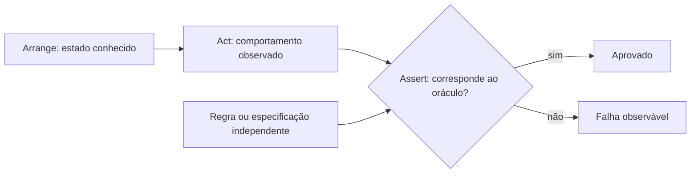
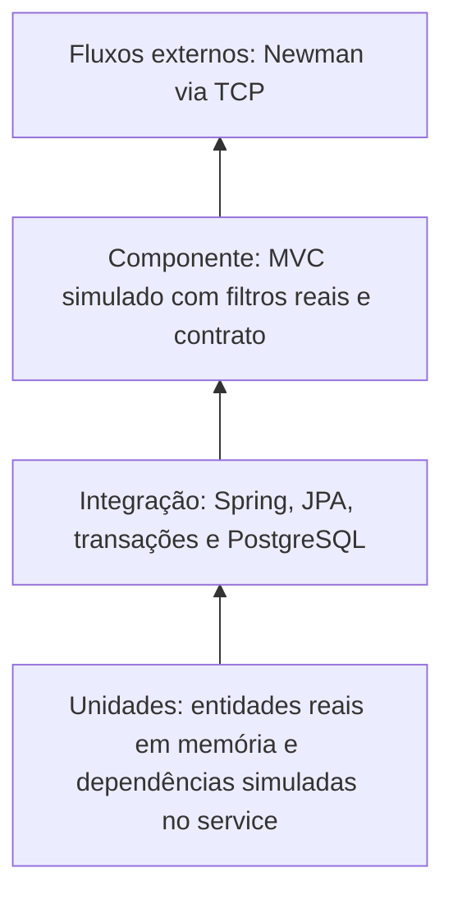
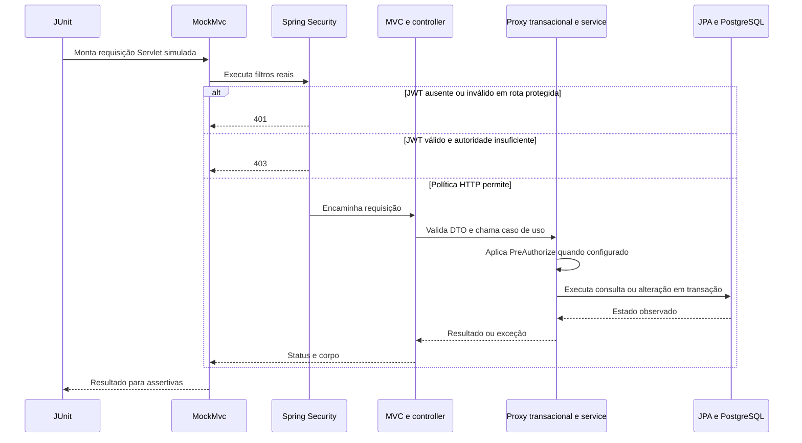
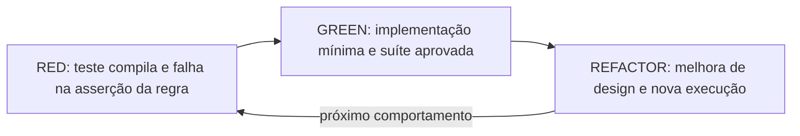
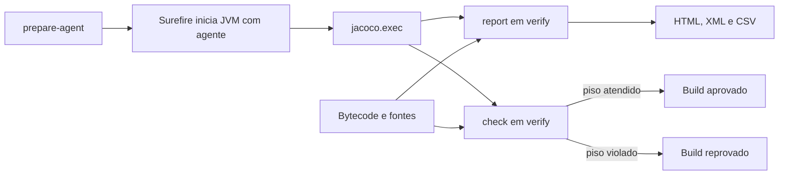

# Aula 15 — Diagramas

## Experimento

## Pirâmide aplicada

## MockMvc, autenticação e autorização

A variante com identidade simulada já fornece o contexto de segurança ao teste. A variante com Bearer real passa pelo decoder. A decisão declarativa do método pode negar a chamada após a passagem pela política HTTP.

## Ciclo TDD

## Cobertura e portão

Relatório e portão usam os dados de execução e as classes compiladas. O relatório HTML facilita a leitura, enquanto o portão calcula os contadores para decidir o resultado do build.
